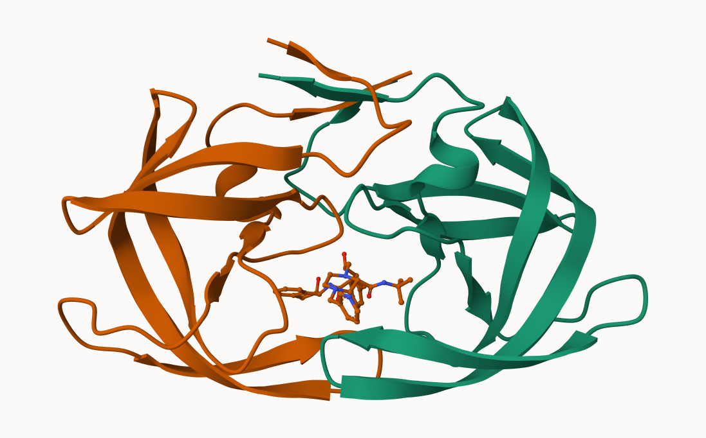
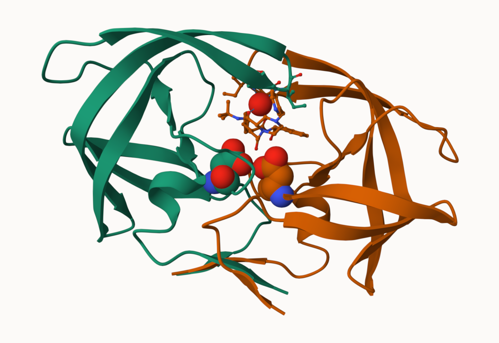
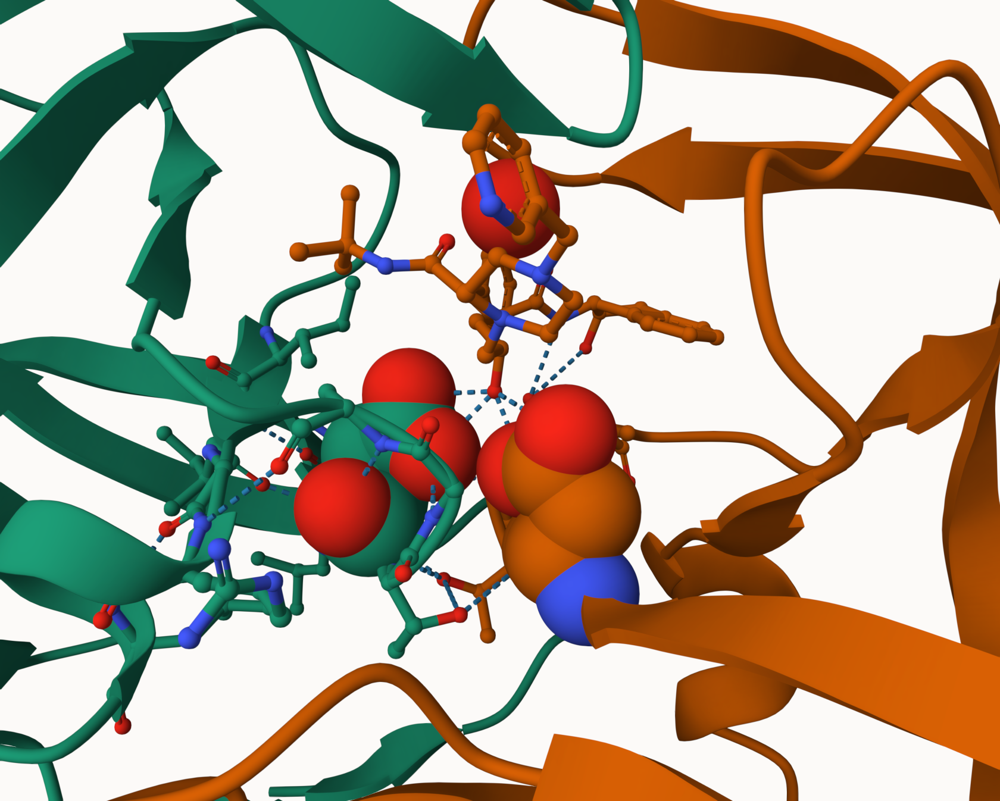
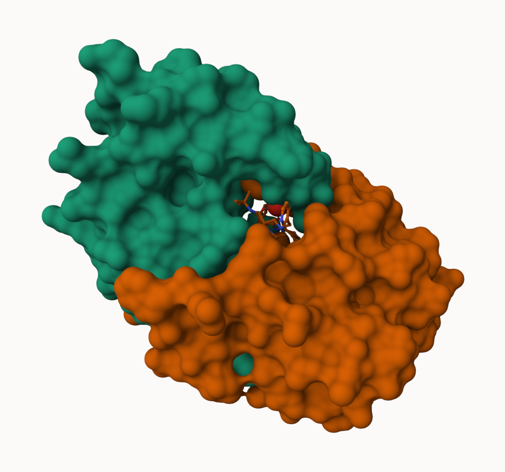
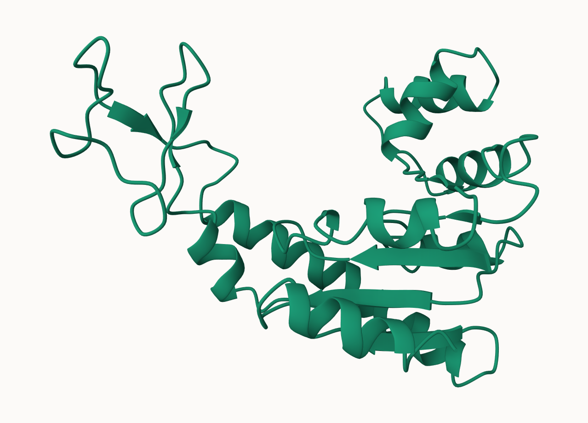
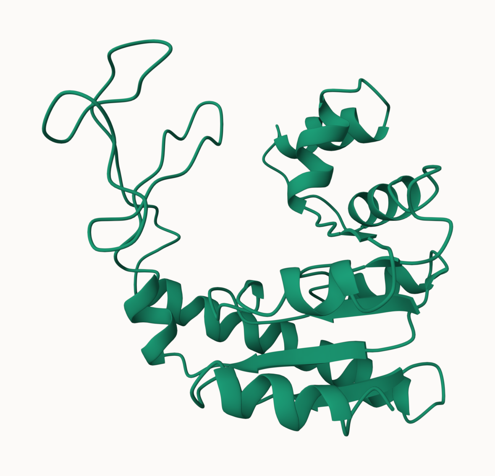

## Background

The [PDB database](https://www.rcsb.org) is the main repository of biomolecular data:

We can "scrape" the PB statistics data from [here](https://www.rcsb.org/statistics/summary) with the **datapasta** package.

```{r, echo=F}
pdb <- data.frame(
  stringsAsFactors = FALSE,
       check.names = FALSE,
           Molecular.Type = c("Protein",
                              "Protein/Oligosaccharide","Protein/NA",
                              "Nucleic acid (only)","Other","Oligosaccharide (only)",
                              "Total"),
              Xray = c(184948, 10729, 9345, 3222, 178, 11, 208433),
                EM = c(25926, 4048, 7539, 347, 27, 1, 37888),
               NMR = c(12907, 34, 288, 1599, 35, 6, 14869),
       Integrative = c(365L, 8L, 27L, 3L, 4L, 0L, 407L),
  Multiple.methods = c(232L, 11L, 8L, 15L, 0L, 1L, 267L),
           Neutron = c(86L, 1L, 0L, 3L, 0L, 0L, 90L),
             Other = c(32L, 0L, 0L, 1L, 0L, 4L, 37L),
             Total = c(224496, 14831, 17207, 5190, 244, 23, 261991)
       )
```

#notice the `{r, echo=F}` in the code that would be above if you could see it. but you can't! 

## Introduction to the RCSB Protein Data Bank (PDB)

### PDB statistics

```{r}
pdb
```

> Q1. What percentage of structures in the PDB are solved by X-ray and Electrom Microscopy?

```{r}
total.ind <- pdb$Molecular.Type == "Total"

n.xray <- pdb$Xray[total.ind]
n.em <- pdb$EM[total.ind]
n.total <- pdb$Total[total.ind]

n.xray/n.total
n.em/n.total
```

> Q2. What percent of structures in the PDB are protein?

```{r}
total.all <- pdb$Total[total.ind]
#the following two lines are zeroing in on the row1 colomn8
protein.ind <- pdb$Molecular.Type == "Protein"
n.protein <- pdb$Total[protein.ind]

n.protein/total.all
```

> Q3. Total number of protein structures?

```{r}
round(224496/149430635 * 100, 2)
```


## Visualizing the HIV-1 protease structure

[Mol*](https://molstar.org/viewer/)

### Molstar viewer









>Q4. Water molecules normally have 3 atoms. Why do we see just one atom per water molecule in this structure?

We only the oxygens as little dots because the hydrogens are smaller than this resolution.


>Q5. There is a critical “conserved” water molecule in the binding site. Can you identify this water molecule? What residue number does this water molecule have?

H2O 308

>Q6. Generate and save a figure clearly showing the two distinct chains of HIV-protease along with the ligand. You might also consider showing the catalytic residues ASP 25 in each chain and the critical water (we recommend “Ball & Stick” for these side-chains). Add this figure to your Quarto document.

See above! 


## Reading structural data into R 

```{r}
library(bio3d)

hiv <- read.pdb("1hsg")
hiv
```

```{r}
head(hiv$atom)
```


```{r}
library(bio3dview)

pdbseq(hiv)
```


### Quick PDB visualization in R


```{r}
library(bio3dview)

asp <- atom.select(hiv, resno= 25)

#view.pdb(hiv, highlight = asp)
```


>Q7. How many amino acid residues are there in this pdb object? 

198 aa residues

>Q8. Name one of the two non-protein residues? 

Non-protein/nucleic resid values: [ HOH (127), MK1 (1) ]

>Q9. How many protein chains are in this structure? 

Chains#: 2  (values: A B)


## Predict protein dynamics


Let's predict the internal dynamics and flexibility of ADK:

```{r}
adk <- read.pdb("6s36")
adk
#this is making the prediction.
```

```{r}
m <- nma(adk)
plot(m)
```

```{r}
#view.nma(m)
```


```{r}
mktrj(m, file="adk_dynamics.pdb")
```







