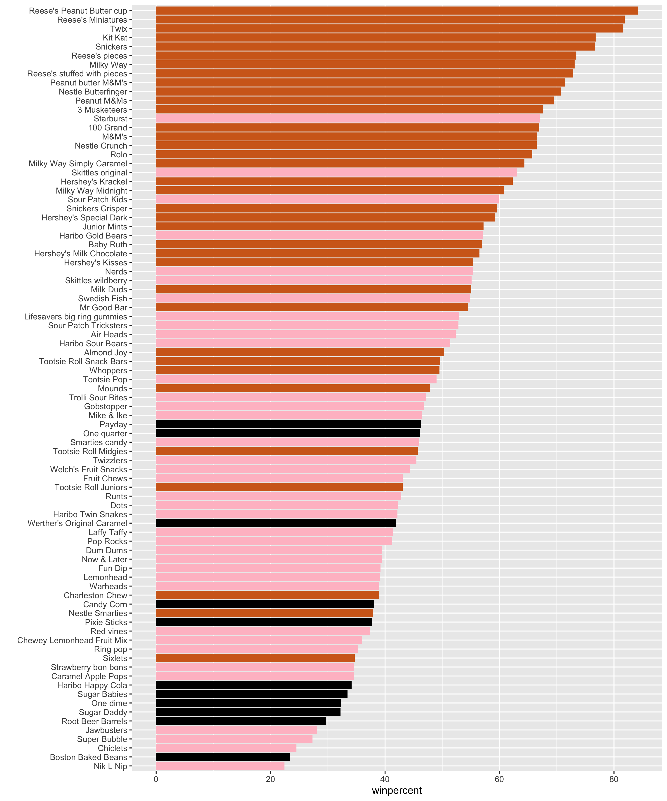

## Importing Candy Data

```{r}
candy_file <- "candy-data.csv"

candy = read.csv(candy_file, row.names="competitorname")
head(candy)
```

## Data Import

> Q1. How many different candy types are in this dataset?

```{r}
nrow(candy)
```

> Q2. How many fruity candy types are in the dataset?

```{r}
sum(candy$fruity)
```

### What is your favorite candy

```{r}
library(dplyr)

candy |> 
  filter(row.names(candy)=="Twix") |> 
  select(winpercent)
```


> Q3. What is your favorite candy (other than Twix) in the dataset and what is it’s winpercent value?

```{r}
library(dplyr)

candy |> 
  filter(row.names(candy)=="Almond Joy") |> 
  select(winpercent)
```

> Q4. What is the winpercent value for “Kit Kat”?

```{r}
library(dplyr)

candy |> 
  filter(row.names(candy)=="Kit Kat") |> 
  select(winpercent)
```

> Q5. What is the winpercent value for “Tootsie Roll Snack Bars”?

```{r}
library(dplyr)

candy |> 
  filter(row.names(candy)=="Tootsie Roll Snack Bars") |> 
  select(winpercent)
```

There is a useful `skim()` function in the skimr package that can help give you a quick overview of a given dataset. Let’s install this package and try it on our candy data.

```{r}
library("skimr")
skim(candy)
```

> Q6. Is there any variable/column that looks to be on a different scale to the majority of the other columns in the dataset?

Yes, the "winpercent" variable is on a very different scale.

```{r}
skimr::skim(candy)
```


> Q7. What do you think a zero and one represent for the candy$chocolate column?

1 means that there is chocolate in the candy and 0 means that there is not.

## Exploratory Analysis

A good place to start any exploratory analysis is with a histogram. You can do this most easily with the base R function `hist()`. Alternatively, you can use `ggplot()` with `geom_hist()`. Either works well in this case and (as always) its your choice.

> Q8. Plot a histogram of winpercent values using both base R and ggplot2.

```{r}
hist(candy$winpercent)
```

```{r}
library(ggplot2)

ggplot(candy, aes(winpercent)) +
  geom_histogram(binwidth=10)
```

> Q9. Is the distribution of winpercent values symmetrical?

No, the distribution is not symmetrical. It's skewed left-ish

> Q10. Is the center of the distribution above or below 50%?

The center of the distribution is below 50%.

```{r}
median(candy$winpercent)
mean(candy$winpercent)
summary(candy$winpercent)
```

> Q11. On average, is chocolate candy higher or lower ranked than fruit candy?

```{r}
chocolate <- candy$winpercent[as.logical(candy$chocolate)]
fruity <- candy$winpercent[as.logical(candy$fruity)]


mean(chocolate)
mean(fruity)
```

On average, the chocolate candies are ranked higher.

> Q12. Is this difference statistically significant?

```{r}
t.test(chocolate, fruity)
```

Yes, this difference is significant! p = 2.871e-08

## Overall candy rankings

Let’s use the base R `order()` function together with `head()` to sort the whole dataset by a variable/column of interest. Or if you have been getting into the tidyverse and the dplyr package you can use the `arrange()` function together with `head()` to do the same thing and answer the following questions:

> Q13. What are the five least liked candy types in this set?

```{r}
head(candy[order(candy$winpercent, decreasing=F),], n=5)
```

> Q14. What are the top 5 all time favorite candy types out of this set?

```{r}
head(candy[order(candy$winpercent, decreasing=T),], n=5)
```

> Q15. Make a first barplot of candy ranking based on winpercent values.

To set all the colors we want:
```{r}
my_col <- rep("black", nrow(candy))
my_col[as.logical(candy$chocolate)] <- "chocolate"
my_col[as.logical(candy$fruity)] <- "pink"
```


```{r}
library(ggplot2)

ggplot(candy) + 
  aes(winpercent, reorder(rownames(candy),winpercent), winpercent) +
  geom_col(fill=my_col) +
  ylab("")
  
```

To make the graph legible:
```{r}
ggsave(filename = "barplot.png", 
       height = 30, width = 25, unit = "cm")
```



> Q17. What is the worst ranked chocolate candy?

Sixlets is the worst ranked chocolate cnady.


> Q18. What is the best ranked fruity candy?

Starburst is the best ranked fruity candy


```{r}
library(ggrepel)

ggplot(candy) +
  aes(winpercent, pricepercent, 
      labels=rownames(candy)) +
  geom_point(col=my_col) +
  geom_text_repel(col=my_col, max.overlap = 7)
```

> Q19. Which candy type is the highest ranked in terms of winpercent for the least money - i.e. offers the most bang for your buck?

The Reese's minis are definitely best bang for your buck.


> Q20. What are the top 5 most expensive candy types in the dataset and of these which is the least popular?

```{r}
head(candy[order(candy$pricepercent, decreasing=T),], n=5)
```

The least popular of the most expensive candies is the Nik L Nip.

## Correlation Analysis

```{r}
library(corrplot)
cij <- cor(candy)

corrplot(cij)
```

> Q22. Examining this plot what two variables are anti-correlated (i.e. have minus values)?

Fruity and chocolate are very much anti-correlated.

> Q23. Use your corrplot result to make a prediction: which variables do you expect will have the largest contributions (i.e. loadings) to PC1 (i.e., drive the most separation between candies along the first principal component)?

I would predict that 

## PCA

```{r}
pca <- prcomp(candy, scale=T)
summary(pca)
```

A scoreplot of my PCA results 

```{r}
library(ggplot2)
library(ggrepel)

ggplot(pca$x) +
  aes(PC1, PC2, labels=row.names(pca$x)) +
  geom_point(col=my_col) +
  geom_text_repel(col=my_col)
```

And a nicer version witha plot title, subtitle, caption and point size scaled by winpercent:

```{r}
library(ggplot2)
library(ggrepel)

# Make a new data-frame with our PCA results and candy data
my_data <- cbind(candy, pca$x)

p <- ggplot(pca$x) +
  aes(PC1, PC2, labels=row.names(pca$x),
            size=candy$winpercent/100,  
            text=rownames(my_data),
            label=rownames(my_data)) +
  geom_point(col=my_col)

  
p + geom_text_repel(size=3.3, col=my_col, max.overlaps = 7)  + 
  theme(legend.position = "none") +
  labs(caption ="Data from 538",
       title="Halloween Candy PCA Space",
       subtitle="Colored by type: chocolate bar (dark brown), chocolate other (light brown), fruity (red), other (black)")
```

> Q24. Complete the code to generate the “Halloween Candy PCA Space Map” above. Be sure to have legable labels along with a plot title and subtitle:

See above.

Interactive plot:

```{r}
library(plotly)
#ggplotly(p)
```


Let’s finish this section by taking a quick look at our PCA loadings. Do these make sense to you? Notice the opposite effects of chocolate and fruity and the similar effects of chocolate and bar (i.e. we already know they are correlated).

```{r}
ggplot(pca$rotation) +
  aes(PC1, 
      reorder(row.names(pca$rotation), PC1), 
      fill=PC1) +
  geom_col() +
  ylab("")
```

> Q25. Complete the code to generate the loadings plot above. What original variables are picked up strongly by PC1 in the positive direction? Do these make sense to you? Where did you see this relationship highlighted previously?

Fruity is probably picked up in the pos direction. This does make sense because it is most opposite to chocolate. We saw this is in the correlation analysis!


> Q26. Based on your exploratory analysis, correlation findings, and PCA results, what combination of characteristics appears to make a “winning” candy? How do these different analyses (visualization, correlation, PCA) support or complement each other in reaching this conclusion?

A winning candy is a chocolate bar! All of the analyses corrolated chocolate and bar as well as indicating both of these variables' popularity. 


```{r}
# Read a mystery 3D dataset - what could it be?
m <- read.csv("mystery.csv")
head(m)
```

Visualize:

```{r}
library(scatterplot3d)
scatterplot3d(m)
```

> Q27. Hmm… can you tell what the mystery dataset represents from this 3D plot? Hint: It is something that goes well with chocolate in Barry’s opnion.

No idea. but it looks like a submarine.

```{r}
# Step 1: Compute the covariance matrix
cij <- cov(m)
cij

# Step 2: Eigen decomposition of the covariance matrix
ans <- eigen(cij)

eigenval <- ans$values   # variance captured by each PC
eigenvec <- ans$vectors  # the new axes (principal components)

# How much variance does each PC capture?
round(cumsum(eigenval) / sum(eigenval) * 100, 2)
```

> Q28. What percentage of the total variance is captured by the first two principal components together? Does this seem like enough to get a meaningful 2D representation of a 3D object?

83.49%, this does seem like a reasonable amount.

```{r}
# Step 3: Project data onto the top 2 eigenvectors
scores <- as.matrix(m) %*% eigenvec[, 1:2]

# Set some colnames for easier plotting
colnames(scores) <- c("PC1", "PC2")
```


```{r}
m <- read.csv("mystery.csv")

p <- prcomp(m)

ggplot(p$x) +
  aes(PC1, PC2) +
  geom_point()
```

> Q29. What is the mystery dataset? Does it make sense that PCA was able to recover a recognizable 2D view from 3D data? What has been “lost” in the reduction from 3D to 2D?

The mystery dataset is a teapot :D
Depth has been lost 2D->3D, but the 2D is still a totally reasonable representation for the dataset. 

```{r}
ggplot(p$x) +
  aes(PC1, PC2) +
  geom_point(size=2, col="steelblue", alpha=0.5) +
  labs(title="Mystery dataset: PCA projection",
       subtitle="3D structure recovered in 2D") +
  theme_bw()
```

> Q30. Do the results from `prcomp()` match your manual eigen decomposition? The scores may differ in sign (direction) — this is normal and does not affect interpretation. Why do you think this is?

These are the same plots, so our manual calc is the same as the prcomp(). The orientation doesn't matter because the only thing that really matters is the distance from 0 for each point. 


